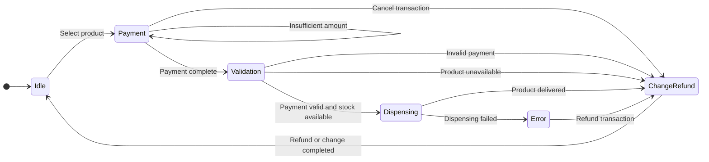

# Session 01 — Initial FSM

## 1. Objective

The objective of this session is to define an initial Finite-State Machine (FSM) for the Smart Vending Machine.

## 2. System States

- Idle: The machine is waiting for a product selection.
- Payment: The machine receives payment through coins or a card.
- Validation: The machine validates the payment and checks product availability.
- Dispensing: The machine dispenses the selected product.
- ChangeRefund: The machine returns change or refunds the payment.
- Error: Product dispensing has failed.

## 3. Inputs

- Product selection
- Coin insertion
- Successful payment
- Insufficient payment
- Transaction cancellation
- Invalid payment
- Product availability
- Product dispensing result

## 4. Outputs

- Product price
- Payment status
- Remaining amount
- Product dispensing command
- Change or refund
- Error message
- Transaction completion message

## 5. Initial FSM Diagram

## 6. State Transition Table

| Current State | Input / Condition | Next State | Output |
|---|---|---|---|
| Idle | Select product | Payment | Display price |
| Payment | Insufficient amount | Payment | Display remaining amount |
| Payment | Payment complete | Validation | Start validation |
| Payment | Cancel transaction | ChangeRefund | Refund request |
| Validation | Valid payment and stock available | Dispensing | Dispensing command |
| Validation | Invalid payment | ChangeRefund | Error and refund request |
| Validation | Product unavailable | ChangeRefund | Unavailable message and refund request |
| Dispensing | Product delivered | ChangeRefund | Delivery confirmation |
| Dispensing | Dispensing failed | Error | Error message |
| Error | Refund transaction | ChangeRefund | Refund request |
| ChangeRefund | Refund or change completed | Idle | Transaction completion |

## 7. Assumptions and Limitations

- The initial state is Idle.
- Payment is represented at an abstract level; detailed banking operations are outside the initial model.
- Product availability is treated as an input to the validation step.
- Inventory tracking and detailed refund failure handling will be refined in later sessions.
