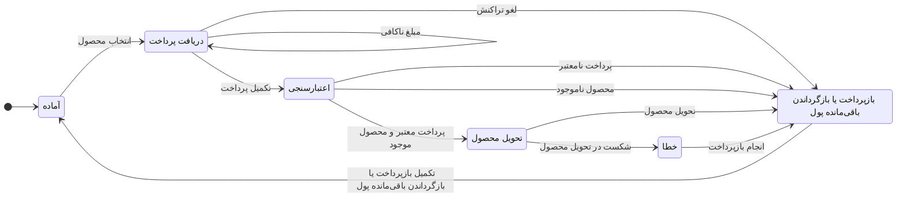

# جلسه ۰۱ — ماشین حالت متناهی اولیه

## ۱. هدف

هدف این جلسه، تعریف یک ماشین حالت متناهی (FSM) اولیه برای دستگاه فروش خودکار هوشمند است.

## ۲. حالت‌های سیستم

- **آماده (Idle):** دستگاه منتظر انتخاب محصول است.
- **دریافت پرداخت (Payment):** دستگاه وجه را از طریق سکه یا کارت دریافت می‌کند.
- **اعتبارسنجی (Validation):** دستگاه اعتبار پرداخت را بررسی می‌کند و از موجود بودن محصول اطمینان حاصل می‌کند.
- **تحویل محصول (Dispensing):** دستگاه محصول انتخاب‌شده را تحویل می‌دهد.
- **بازگرداندن باقی‌مانده پول یا بازپرداخت (ChangeRefund):** دستگاه باقی‌مانده پول را برمی‌گرداند یا وجه پرداخت‌شده را بازپرداخت می‌کند.
- **خطا (Error):** فرایند تحویل محصول با شکست مواجه شده است.

## ۳. ورودی‌ها

- انتخاب محصول
- وارد کردن سکه
- پرداخت موفق
- پرداخت ناکافی
- لغو تراکنش
- پرداخت نامعتبر
- وضعیت موجودی محصول
- نتیجه تحویل محصول

## ۴. خروجی‌ها

- نمایش قیمت محصول
- وضعیت پرداخت
- نمایش مبلغ باقی‌مانده
- فرمان تحویل محصول
- بازگرداندن باقی‌مانده پول یا بازپرداخت وجه
- پیام خطا
- پیام تکمیل تراکنش

## ۵. نمودار اولیه ماشین حالت

## ۶. جدول انتقال حالت‌ها

| حالت فعلی | ورودی / شرط | حالت بعدی | خروجی |
|---|---|---|---|
| آماده | انتخاب محصول | دریافت پرداخت | نمایش قیمت |
| دریافت پرداخت | مبلغ ناکافی | دریافت پرداخت | نمایش مبلغ باقی‌مانده |
| دریافت پرداخت | تکمیل پرداخت | اعتبارسنجی | شروع بررسی پرداخت |
| دریافت پرداخت | لغو تراکنش | بازپرداخت یا بازگرداندن باقی‌مانده پول | درخواست بازپرداخت |
| اعتبارسنجی | پرداخت معتبر و محصول موجود | تحویل محصول | فرمان تحویل محصول |
| اعتبارسنجی | پرداخت نامعتبر | بازپرداخت یا بازگرداندن باقی‌مانده پول | نمایش خطا و درخواست بازپرداخت |
| اعتبارسنجی | محصول ناموجود | بازپرداخت یا بازگرداندن باقی‌مانده پول | اعلام ناموجود بودن محصول و درخواست بازپرداخت |
| تحویل محصول | تحویل موفق | بازپرداخت یا بازگرداندن باقی‌مانده پول | تأیید تحویل |
| تحویل محصول | شکست در تحویل محصول | خطا | نمایش پیام خطا |
| خطا | انجام بازپرداخت | بازپرداخت یا بازگرداندن باقی‌مانده پول | درخواست بازپرداخت |
| بازپرداخت یا بازگرداندن باقی‌مانده پول | تکمیل بازپرداخت یا بازگرداندن باقی‌مانده پول | آماده | پیام تکمیل تراکنش |

## ۷. فرضیات و محدودیت‌ها

- حالت اولیه دستگاه، حالت **آماده** است.
- پرداخت به‌صورت انتزاعی مدل‌سازی شده است؛ جزئیات عملیات بانکی خارج از محدوده مدل اولیه هستند.
- موجود بودن محصول به‌عنوان ورودی مرحله اعتبارسنجی در نظر گرفته می‌شود.
- مدیریت موجودی محصولات و بررسی دقیق شکست در فرایند بازپرداخت در جلسات بعدی تکمیل خواهند شد.
